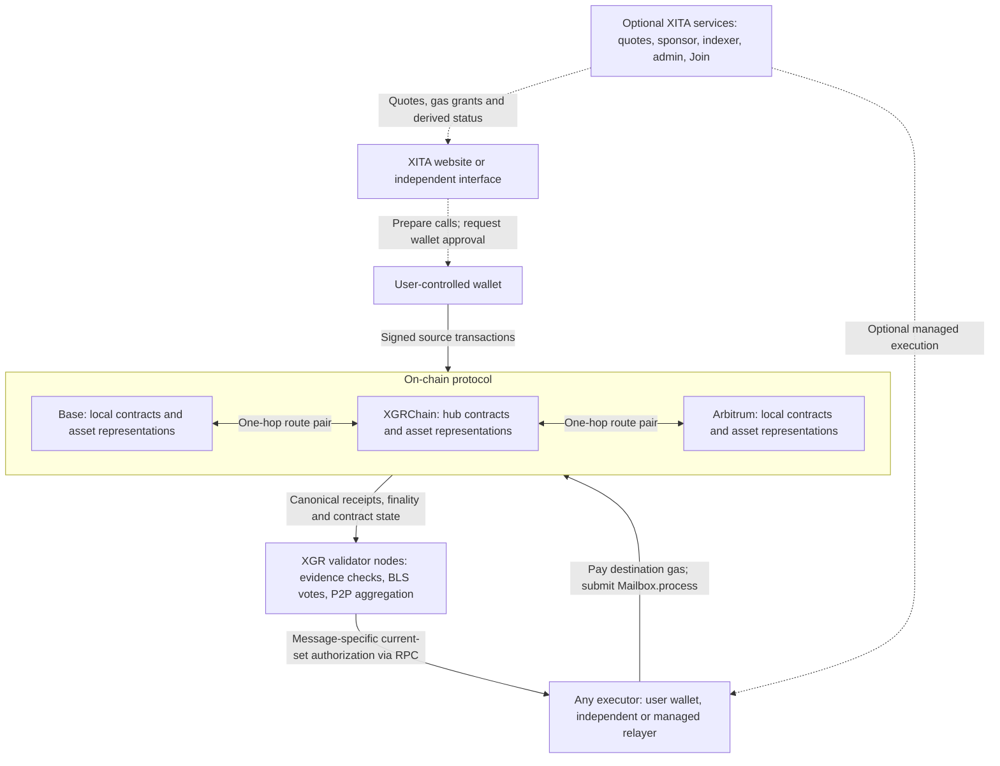
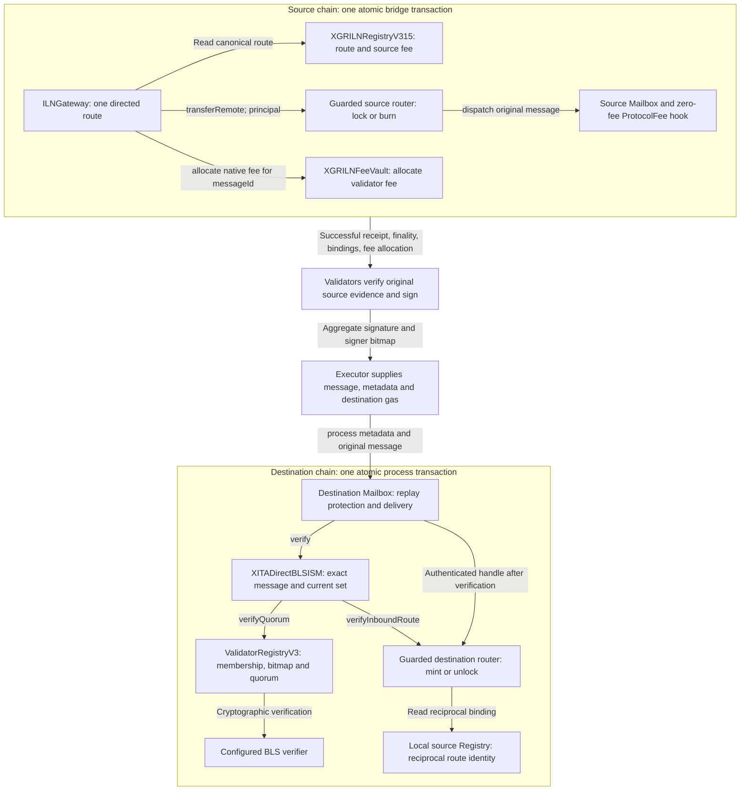
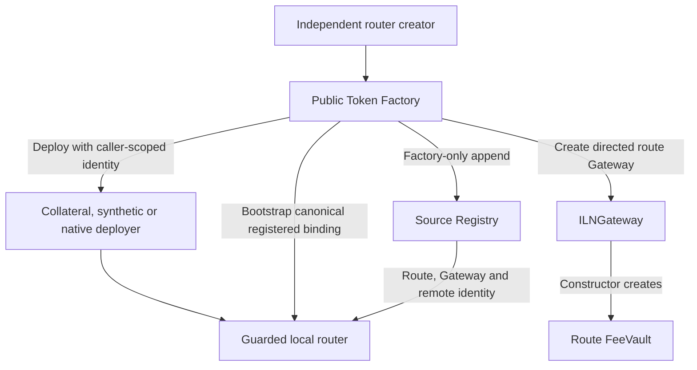

# System context and contract interactions

[Documentation index](README.md) · [Contract methods and fees](XGR_INTERCHAIN_Contract_Reference.md) · [Declared Solidity API](XGR_INTERCHAIN_Contract_API.md)

Baseline: public node v3.4.0 and the Direct-BLS implementation identified in the [source map](XGR_INTERCHAIN_Source_Map.md). The diagrams describe implementation roles, not a claim that every deployment is live. Contract names below are exact source names; suffixes are contract-family versions, not node release versions.

## 1. Whole-system context

Solid arrows show transactions or data dependencies; dotted arrows show optional application assistance. An arrow between a chain and a validator denotes evidence reading, not that the chain sends assets to the validator.

Base↔Arbitrum is a two-hop journey through XGRChain. The chain connections represent authenticated lock/burn and mint/unlock operations, not movement of one token object between chains. XGR validator nodes read their own committed XGRChain state locally; Base and Arbitrum evidence uses the configured remote RPC operators and checked `safe` policy. Validators communicate votes over their P2P runtime. The public RPC exposes requests and quorum results; it is not an arbitrary signing oracle.

XITA's website, indexer, quote signer, sponsor and managed executor can be replaced or omitted. Direct users call the public Gateway, obtain valid authorization and fund destination execution. The optional sponsor sends native gas to user-controlled wallets; it does not sign their transfers. Join and the admin deployment workflow organize XITA's catalog and deployments; public Factory registration does not depend on catalog approval. [Services](XGR_INTERCHAIN_Services.md) specifies the separate processes and APIs.

## 2. One hop: contracts and trust boundaries

Each physical chain has its own local infrastructure. A chain's source Registry and Validator Registry are different contracts. A chain acting as destination uses its local source Registry for the recipient router's reciprocal binding.

`bridge` moves principal and dispatches before calling `FeeVault.allocate`; a failure in allocation reverts the entire source transaction, including token movement and dispatch. The destination ISM does not fetch remote RPC evidence inside Solidity: validators check that evidence off-chain and sign its canonical binding. The ISM checks the exact message hash/header, current set and local reciprocal router identity, then delegates quorum and cryptographic verification to the destination Registry/verifier.

Mailbox authentication and the router's enrolled remote protect inbound handling. An executor may submit valid calldata but cannot replace the recipient, amount, source router or asset. If destination execution reverts, its delivered-state update does not persist. Native payout has a separate backed deferred-claim case described below.

## 3. Every production Solidity source and its role

This inventory covers all 21 top-level production `.sol` files in `xgr-interchain/contracts`. Test mocks are excluded. Interfaces and libraries are identified explicitly: they are not additional deployed services. Imported Mailbox and token implementations are listed separately because they are essential even though their source is in dependencies.

| Source | Purpose, interactions and authority |
| --- | --- |
| `XETATokenFactoryV315.sol` | Public per-chain construction and registration entry point. Calls router deployers, creates the source Registry, and creates a Gateway for each directed route. Only a router's recorded creator can register that router's destination binding. Registers the route and bootstraps the router atomically; no company allowlist or route-admission BLS vote. |
| `XETACollateralRouterDeployer.sol` | Construction helper used by the Factory for collateral routers. Scopes the CREATE2 salt to its caller and instantiates the router with token, Registry, Mailbox, hook, ISM and gas settings. Direct use of the helper does not create Factory provenance or a registered route. |
| `XETASyntheticRouterDeployer.sol` | Construction helper for synthetic router/token instances, including decimals/name/symbol. Caller-scoped salt; deploys code but does not grant route admission or mint authority. |
| `XETANativeRouterDeployer.sol` | Construction helper for native routers with caller-scoped salt. Canonical native-XGR chain restrictions are enforced by the public Factory path. Deployment alone is not a usable route. |
| `XGRILNRegistryV315.sol` | Source-side route catalog and shared source-native validator fee. Only its bound Factory registers append-only route records; `applySourceFee` requires valid current-set quorum and correct source/Registry/nonce/expiry. Stores identity, not token collateral. |
| `IXGRILNRegistry.sol` | Read interface and RouteRecord shape consumed by Gateways and routers. It is an ABI contract between components, not another Registry deployment. |
| `XGRILNProtocol.sol` | Library for canonical asset IDs, directed router-pair route IDs and source-fee signing bytes. Factory, Registry and router checks must agree on this encoding; symbols are not identity. |
| `ILNGateway.sol` | Public per-directed-route source entry point. Reads canonical route/fee, pulls ERC-20 principal or accepts native value, calls its guarded router and allocates the message's validator fee. Creates its own FeeVault in its constructor. Source user approves this Gateway for direct ERC-20 transfers. |
| `XGRILNFeeVault.sol` | Route-specific native protocol-fee accounting. Only its Gateway allocates; snapshots fee-recipient membership and message allocation. Validators claim their historical entitlement in bounded pages. It holds fees, not transferred principal or a destination-execution gas bond. |
| `XETARouterCore.sol` | Abstract shared router behavior inherited by all three adapters. Guards the internal outbound entry by the canonical Gateway; records one immutable binding per remote domain; verifies inbound source route identity through the local reciprocal route. Bootstrap is externally callable but constrained by canonical Registry/Gateway bindings, not an unrestricted enrollment permission. |
| `XETAGuardedCollateralWarpRouterV315.sol` | Holds original ERC-20 collateral. Outbound pulls exactly the requested balance increase and rejects fee-on-transfer receipt mismatches; authenticated inbound releases underlying to recipient. Its `token()` returns the underlying token address. Separate router escrows remain separate. |
| `XETAGuardedSyntheticWarpRouter.sol` | Both router and synthetic ERC-20 token through `HypERC20`. Starts with zero supply, burns on guarded outbound and mints on authenticated inbound. `token()` is the router/token itself; there is no separate representation-token contract to approve. Constructor consumes initialization and leaves no privileged owner. |
| `XETAGuardedNativeWarpRouter.sol` | Native-XGR collateral adapter; `token()` is zero. Locks native principal, then pays authenticated inbound recipients with bounded gas. Failed recipient execution creates a fully reserved `pendingNativeXGR` claim; insufficient unreserved backing reverts instead. Only the beneficiary can authorize its withdrawal to an alternative payout address. |
| `XITADirectTransport.sol` | Construction/configuration wrapper that deploys Mailbox and a zero-fee ProtocolFee hook, binds the destination ISM and retains their ownership with no forwarding setter API. It does not relay messages or build proofs at runtime. |
| `XITADirectBLSISM.sol` | Destination message-security module. Checks message/header/hash, current destination set and destination router's reciprocal source identity, then calls Registry quorum verification. It does not hold collateral, create votes or admit routes. |
| `XITADirectProtocol.sol` | Library encoding the exact Direct-BLS authorization, including destination ISM and Validator Registry addresses. Shared signing format must match node/helper codecs. Distinct from asset/route/source-fee encoding in `XGRILNProtocol`. |
| `XGRInterchainValidatorRegistryV3.sol` | Destination-scoped membership, key formats, set snapshots, proof of possession and quorum checks. Calls its configured BLS verifier. Also supplies fee-recipient epochs to the source FeeVault and quorum authority for source-fee changes on that chain. Membership ADD/REMOVE reserve accounting and its `claim()` are separate from FeeVault fee claims. |
| `IXGRInterchainValidatorSetV2.sol` | Shared Registry ABI for set/status/fee-recipient/quorum reads. The V2 interface name is used by RegistryV3 consumers and does not mean that a second V2 Registry must be deployed. |
| `XGRInterchainBLSVerifier.sol` | External-chain EIP-2537 implementation of cryptographic BLS verification. Aggregates bitmap-selected G1 keys, hashes the payload to G2 and checks pairing via precompiles. Registry determines membership/quorum; verifier supplies cryptographic validity. XGRChain's configured native verifier is a different implementation of the same verifier interface. |
| `IXGRInterchainBLSVerifier.sol` | Verifier ABI used by the Validator Registry. Allows native compressed verification on XGRChain and the EIP-2537 implementation on external chains, using the Registry's configured key/signature format. |
| `XITAExecutionGateway.sol` | Optional commercial adapter in front of the public Gateway. Verifies payer-bound EIP-712 quotes signed by `serviceWallet`, collects service fees, and calls public `bridge`. Supports wallet-authorized `continueJourney`. Recovery owner can rotate the service wallet; quote lifetime may be changed only by owner. Neither role gains public protocol mint/route/quorum authority. |

### Imported contracts and native verification

| Dependency | Interaction |
| --- | --- |
| `Mailbox` | Source dispatch assigns message identity and emits the message; destination `process` applies replay protection, invokes the recipient's ISM and calls authenticated router handling. Local Mailbox addresses differ by chain. |
| `ProtocolFee` | The transport's default and required dispatch hook; configured with zero maximum/current fee. No Merkle leaves, roots or inclusion-proof state. The source Gateway's positive validator fee is independent of this hook. |
| `TokenRouter`, `HypERC20`, `NativeCollateral` | Supply inherited dispatch, authenticated handling, synthetic ERC-20 mint/burn and native-value behavior. `XETARouterCore` guards inherited outbound paths too. Use the pinned dependency ABI for inherited functions, not only the declared-source inventory. |
| Existing original ERC-20 | External asset contract locked by the collateral adapter. Token behavior remains an integration assumption; the bridge cannot change original token administration. |
| XGRChain native BLS verifier | Native verification at `0x0000000000000000000000000000000000002040`, implemented by the node. Uses compressed verification format. Base/Arbitrum use the configured EIP-2537 verifier with uncompressed points; this is not an additional validator vote. |

## 4. Construction and route registration

Shared transport, Validator Registry/verifier and ISM must exist before the Factory is usable. `deployRegistry()` provides the Factory-bound source Registry. Router creation and registration on one chain cannot deploy or inspect the counterpart's live code on another chain. Both local router creators must establish matching reciprocal bindings; each local `registerRoute` transaction creates its Gateway/FeeVault, appends its record and bootstraps its router atomically. An incomplete remote side is not a transfer-ready pair.

The source and reverse route IDs differ because direction and router order are encoded. The destination ISM checks the signed source route using its recipient router's local reverse binding. A hub router can bind several spoke domains; parallel router pairs can represent the same canonical asset with different route IDs and escrow instances. Do not infer one global route from one Factory or one shared Registry.

## 5. Principal, validator fees and commercial fees

| Value | Path | Result |
| --- | --- | --- |
| Native XGR principal | Wallet → public Gateway → native router | Locked on source; a return delivery pays or reserves the beneficiary claim |
| Original ERC-20 principal | Wallet allowance to Gateway → Gateway → collateral router | Original token remains escrowed; authenticated return releases it |
| Synthetic principal | Wallet allowance to Gateway → Gateway → synthetic router/token burn | Destination authenticated router mints its representation or releases original collateral |
| Protocol validator fee | Gateway → its FeeVault → entitled validator's claim | Native source-chain currency; allocation belongs to the original message and fee-recipient epoch |
| Optional commercial fee | Wallet → XITAExecutionGateway → service-wallet claim | Separate from protocol fee; can be withdrawn before destination completion |
| Transaction gas | Signing/broadcasting account → chain execution | Source and destination gas are separate; no automatic conversion of FeeVault fees into destination gas |
| Optional sponsored gas | Sponsor wallet → user's chain-native balance | Funds eligible wallet actions; the user retains transaction-signing authority |

Direct ERC-20 users approve `ILNGateway`. When using the optional commercial adapter, the user instead follows its allowance path: adapter pulls the token and approves the public Gateway. Synthetic token and router addresses coincide; collateral token and router addresses do not. Exact native quote value includes the native principal only where appropriate, never twice.

## 6. Two-hop journey and completion

A Base→Arbitrum journey consists of Base→XGRChain followed by XGRChain→Arbitrum. Hop one produces a hub balance or native payout for its beneficiary. The user authorizes the onward source action; neither an attestation nor a managed relayer can spend that balance merely because hop one succeeded. Each hop repeats the source Gateway/router/FeeVault and destination Mailbox/ISM/router path above with distinct route and message IDs. The optional `continueJourney` records parent linkage; direct use can call the next public Gateway independently.

For every hop distinguish source receipt success, quorum readiness, destination receipt success and actual recipient settlement. `Mailbox.delivered` alone does not distinguish immediate native payment from a backed deferred claim. A rejecting contract recipient must itself be able to invoke `withdrawPendingNativeXGR`; neither the service operator nor another relayer can withdraw on its behalf. This describes an existing contract recovery mechanism, not a newly added normal UI signing step or an operator-funded payout promise.

A current-set rotation requires fresh authorization for the original message; it never requires another source lock. Missing quorum or invalid evidence cannot be solved by replacing the relayer. Source token behavior, receipt availability, remote RPC evidence and chain finality remain explicit assumptions in the [security model](XGR_INTERCHAIN_Security_Model.md).

## 7. Code anchors for maintaining these diagrams

- `XETATokenFactoryV315.registerRoute`: Gateway creation, Factory-only Registry append, router bootstrap.
- `ILNGateway.bridge`: principal movement, router dispatch, atomic FeeVault allocation.
- `XETARouterCore._transferRemote` and `verifyInboundRoute`: outbound authority and reciprocal asset/route checks.
- `XITADirectBLSISM.verify`: message binding, current set, inbound route and Registry quorum.
- `XGRInterchainValidatorRegistryV3.verifyQuorum`: set snapshot, bitmap threshold and verifier call.
- `XITADirectTransport` constructor: immutable transport ownership and zero-fee hook.
- Concrete router `_transferFromSender` / `_transferTo` implementations and inherited `HypERC20`: asset accounting.
- Node `interchain/config.go`, `interchain/evm`, `interchain/runtime`: chain policy, evidence readers and off-chain voting.

The [source map](XGR_INTERCHAIN_Source_Map.md) pins reviewed implementations. Keep this semantic inventory, declared API, operational examples and diagrams synchronized when those source responsibilities change.
