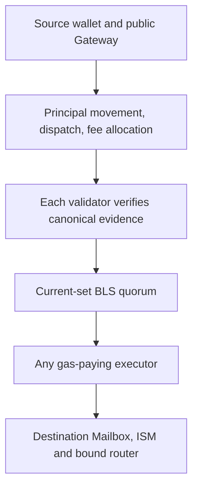

# XGR Interchain architecture

Start with [system context and contract interactions](XGR_INTERCHAIN_Context_and_Contracts.md) for the complete component diagram and individual contract responsibilities.

Baseline: node v3.4.0 and public Direct-BLS contracts/runtime, reviewed 2026-10-27. [Documentation index](README.md).

## 1. System boundaries

XGR Interchain transfers assets over directed routes whose message authorization comes from an eligible BLS quorum. Source asset movement and source-native validator fee allocation occur atomically. Destination delivery verifies the original message against the current destination validator set and the recipient router's own route binding.

The public protocol can be operated without XITA's website, commercial Execution Gateway, sponsor, indexer or managed relayer. Users authorize source transactions with their own wallets. Any account can pay destination gas to submit valid delivery calldata. Validators, suitable chain access, gas, valid routes and protocol fees remain necessary.

| Component | Responsibility | Authority boundary |
| --- | --- | --- |
| Public Token Factory | Deploy routers; create canonical route/Gateway/Registry records | Anyone may create their own routers; only their creator binds each router's routes |
| Source Registry | Append-only directed route identity; current chain-wide source validator fee | Factory registers; quorum changes source fee |
| Public ILNGateway | Quote, move/burn source principal, dispatch and allocate source fee | Caller supplies principal/allowance and exact value |
| Route-specific FeeVault | Message-linked native fee accounting and validator pull claims | Only its bound Gateway allocates |
| Router | Collateral lock/unlock or synthetic burn/mint | Outbound internal entry guarded by bound Gateway; inbound authenticated Mailbox |
| Direct transport | Mailbox and zero-fee ProtocolFee dispatch hook | No Merkle leaf/root store |
| Validator node worker | Discover, verify, sign, aggregate and expose authorizations | Local eligibility and independent canonical evidence; no arbitrary signing RPC |
| Destination ISM/validator registry | Bind message, router pair, destination deployment and current quorum | Cannot be replaced by a relay assertion |
| Executor | Submit `Mailbox.process(metadata,message)` | Pays gas; cannot change signed message or redirect principal |

## 2. Physical networks and mandatory hub

The release's compiled chain policy supports XGRChain (chain/domain 1643), Base (8453) and Arbitrum (42161). XGRChain must be exactly one endpoint of each directed route. Other configured prospects are not automatically active supported networks.

A route XGRChain → Base and its reverse are separate registrations with separate IDs. XGRChain → Arbitrum is another direction. Spoke → spoke journeys require two completed hops through XGRChain. Each hop has its own source transaction, message ID, source fee, attestation and destination gas.

For two hops, the hub recipient first receives the representation or native payout. The wallet then authorizes the onward source operation. Destination delivery of hop one does not by itself authorize spending the recipient's hub assets.

### Why XGRChain is the hub

XGRChain has two distinct responsibilities: it is an actual settlement chain for the intermediate asset in a spoke-to-spoke journey, and its validator operators run the Interchain evidence/signing worker. The hub is not merely a routing label or a centralized API. A Base→Arbitrum journey really settles a first message on XGRChain and starts a second source transaction there.

The hub constraint is enforced by route/asset contracts and node chain policy; it is not just a restriction in the XITA dropdown. Architecturally, connecting each supported spoke to a common hub provides a common place for asset representations and onward transfers. It avoids requiring a direct protocol relationship for every pair of spokes. This is a topology property, not a claim that every asset shares one router or that adding a chain requires no implementation work. Each asset and router pair still needs valid reciprocal bindings.

This design also has explicit costs: a spoke-to-spoke journey needs two authorizations and two deliveries, and depends on XGRChain availability in addition to both spokes. Each hop has separate gas, fees, finality and retry state. The two hops are not one atomic cross-chain transaction; a successful first hop remains successful if the second hop is delayed.

### Why the validators are XGR validators

The implementation reuses XGR validator identities and their BLS keys for a separate Interchain worker. In `interchain/runtime/worker.go`, `interchainSignerEligible` requires the signer to belong to the destination's registered set **and** to exist as an active validator in canonical XGR state with the matching BLS public key. A random relayer or token issuer cannot become an authorized signer merely by calling a public endpoint.

This connects the worker to the XGR validator lifecycle and lets it read XGR source evidence from locally committed chain state. For external source chains, those same operators obtain and check finality-qualified evidence through the configured independent RPC operators. They do not produce Base or Arbitrum blocks and do not replace those chains' consensus.

| Layer | What it establishes | What must not be inferred |
| --- | --- | --- |
| XGR block consensus and PoS state | XGR blocks/state and active validator identity | An XGR block signature alone is not an authorization for an external-chain message |
| Node Interchain worker | Canonical source evidence, signer eligibility, exact per-message BLS votes and aggregation | Worker progress or an indexer status is not destination settlement |
| Per-destination ValidatorRegistry | Registered keys, current set ID, signer order and count-based quorum | Destination sets need not contain every XGR validator or have identical membership |
| Destination ISM and Mailbox | Current-set signature, exact message/route binding, replay protection and authenticated delivery | They do not independently execute XGR PoS or query remote RPCs inside Solidity |

Interchain quorum is `ceil(2*n/3)` of the destination Registry's members, not stake-weighted block consensus. Destination contracts verify their registered set; the canonical-XGR eligibility check is performed by the node implementation. Keeping registry membership and worker eligibility aligned is therefore operationally important. After a set change, the original source message needs current-set authorization, not a new source lock.

The rationale is reuse of the existing validator identity, runtime and communication infrastructure rather than a company-controlled message signer. This does not make cross-chain evidence trustless: external RPC evidence, validator honesty and availability, destination membership and contract correctness remain part of the security model. No automatic Interchain-specific slashing or light-client verification guarantee is implied.

## 3. Multiple assets and parallel route instances

The canonical Asset ID binds original chain, original token address and native/ERC-20 kind. A token symbol, display name or listing is not identity proof. Route IDs additionally bind source/destination chain/domain and router pair.

One router has one immutable route/Gateway binding **per destination domain**. A hub router can therefore serve several spokes. Independently deployed router pairs can create parallel route instances for the same original asset and direction; they have distinct route IDs and may have distinct collateral escrows. There is no single global bridge route and no symbol-based collateral pool.

The deployment records contain native XGR and synthetic XGR representations, and ARB collateral with synthetic representations on the other supported chains. Recorded deployments and current transfer readiness must be checked separately. See [assets](XGR_INTERCHAIN_Asset_Bridge.md) and [inventory](XGR_INTERCHAIN_Deployment_Reference.md).

## 4. Single-hop transaction lifecycle

1. The wallet verifies the intended directed route and reciprocal destination binding, reads token decimals and calls public `quoteILN`.
2. For ERC-20, the wallet approves the source Gateway. It then calls `bridge` with the quoted exact native value. Native principal and protocol fee are separate components of that quote.
3. The Gateway validates canonical bindings. Router movement, Mailbox dispatch and FeeVault allocation either all commit or all revert.
4. Validators discover an operation or receive an untrusted RPC/P2P hint. Each verifies finality, the original successful source receipt, matching Gateway event and canonical Mailbox message, route and durable fee allocation.
5. Eligible validators sign the exact Direct-BLS payload for the current destination set. Votes are persisted and gossiped; completed quorum is archived and available over RPC.
6. An executor reconstructs metadata and verifies/simulates destination processing. The wallet or independent executor broadcasts the unsigned call.
7. Destination Mailbox prevents duplicate delivery; ISM checks current-set authorization and recipient router identity. The router mints, unlocks, or reserves a deferred native payout.
8. Confirm the receipt and recipient result. `delivered(messageId)` is message settlement; a deferred native claim needs an additional recipient-authorized withdrawal.

See the [executable runbook](XGR_INTERCHAIN_v3.4.0_Operations.md).

## 5. Permissionless scope

On an already supported physical chain, public Factory registration requires neither a company token listing nor a validator route-admission vote. The creator pays deployment gas and selects their own router pair; canonical validation and immutable binding still apply. A record is enabled by atomic registration, not a later BLS activation transaction.

Adding a new physical network is a different operation: reviewed transport/registry deployments, supported finality/evidence readers, compiled chain bindings and validator rollout are necessary. Per-token validator environment edits are not part of public route admission.

An independent interface can call the public contracts directly. Application catalog admission does not grant an on-chain protocol privilege.

### Permissionless does not mean unrestricted

| Participant | Independently available action | Remaining condition |
| --- | --- | --- |
| Asset/router creator | Deploy via public Factory and register owned router routes | Supported chain, deployment gas, valid asset identity and reciprocal bindings |
| Transfer user | Quote, approve and call the public Gateway from their wallet | Principal, protocol fee, source gas and a usable route |
| Executor | Obtain authorization and submit destination processing | Valid current-set proof, destination gas and executable recipient/router state |
| Interface/service operator | Build a frontend, discovery index, quote service or executor | Public contract/RPC semantics and the operator's own service responsibilities |
| Validator operator | Participate through the validator lifecycle and Interchain membership mechanisms | Active matching XGR identity, destination membership and evidence validation |

Permissionless asset registration does not let an issuer mint an arbitrary existing representation or release another router's escrow. Public destination execution does not let an executor change the recipient. Permissionless access also does not remove dependencies on a sufficient validator set or authorize unsupported physical chains.

### How optional XITA services fit around the protocol

The website composes wallet calls and presents status. The indexer derives searchable transfer history from chain evidence; it does not own the transfer. The quote service signs commercial terms for the optional Execution Gateway; it cannot sign a user's wallet transaction or replace validator authorization. Gas sponsorship funds eligible wallet actions and carries its own commitment/accounting lifecycle. The managed executor submits already authorized destination calls. Join manages catalog proposals for the application.

These services can cooperate without becoming protocol admission authorities. For example, a listed token still needs valid contracts and a real source transfer; an unlisted independently registered route can be used through the public protocol. A website outage can hide status without reversing on-chain state. An executor outage leaves a valid message available for independent delivery. Missing validator quorum remains a protocol availability problem that another frontend cannot fix.

## 6. Transport and implementation dependencies

`XITADirectTransport` constructs a Mailbox and a zero-fee `ProtocolFee` hook; Mailbox default and required hooks refer to it. The `dispatchHook` field remains a real contract binding. It is not a MerkleTreeHook and does not store message leaves or supply an inclusion proof.

Hyperlane-compatible message/TokenRouter library types remain implementation dependencies. That does not imply operation through the retired project repository or dependence on its managed infrastructure. The maintained bridge implementation is `xgr-interchain`. The former `xgr-hyperlane` repository name is only historical migration context.

XGRChain's own state, transaction and receipt tries remain part of ordinary chain execution. Direct-BLS concerns Interchain authorization, not removal of those tries.

## 7. Costs and availability

Costs comprise source gas, source-native protocol validator fee, principal, and destination gas. Optional commercial quote fees and sponsored gas are separate. The source FeeVault is not a destination gas escrow and does not promise a commercial service refund.

A managed relay outage can be bypassed with public unsigned recovery. Missing validator quorum, invalid source evidence, unavailable required finality or insufficient escrow cannot be bypassed by choosing a different executor. Source receipt retention and destination current-set availability affect recovery.

Technical non-custodial wallet control and service independence should be described through these concrete permissions. They do not themselves determine a legal or regulatory classification.

## 8. Reading and version discipline

[Security](XGR_INTERCHAIN_Security_Model.md) specifies exact bytes and trust assumptions. [Runtime](XGR_INTERCHAIN_Validator_Runtime.md) explains observation and persistence. [Services](XGR_INTERCHAIN_Services.md) covers optional applications. [Source map](XGR_INTERCHAIN_Source_Map.md) identifies the corresponding code.

The node's v3.4.0 `securityAccounting` fork changes chain execution accounting. It does not replace the Direct-BLS format, deploy new bridge contracts or make a recorded asset route ready without verification.
