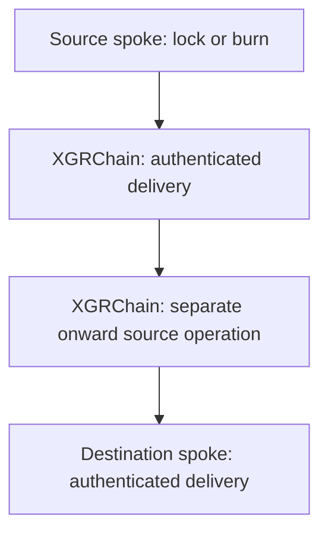

# XGR Interchain / XITA — v3.4.0 technical reference

**Reviewed:** 2026-10-27. **Node baseline:** [xgr-node v3.4.0](https://github.com/xgr-network/xgr-node/tree/v3.4.0). **Contracts, website and recovery tooling:** [xgr-interchain](https://github.com/xgr-network/xgr-interchain). Contract suffixes such as V315 and V2 are interface-family identifiers; upgrading the node to v3.4.0 does not require redeploying these contracts.

## 1. Scope and source authority

This reference supersedes the earlier v3.2.3 Merkle-based runtime description for current use. The implementation now uses **Direct-BLS authorization of individual messages**, not Interchain checkpoint-root signatures, MerkleTreeHook inclusion or replica-prefix reconstruction. XGRChain's consensus state, transaction and receipt tries are unrelated and remain in use.

| Subject | Implementation authority |
| --- | --- |
| Network identity and source finality | `xgr-node/interchain/config.go` at the release tag |
| Source entry point and fee allocation | `xgr-interchain/contracts/ILNGateway.sol`, `XGRILNFeeVault.sol` |
| Permissionless registration and identity | `XETATokenFactoryV315.sol`, `XGRILNRegistryV315.sol`, `XGRILNProtocol.sol` |
| Destination authentication | `XITADirectBLSISM.sol`, destination validator registry and BLS verifier |
| Exact signed bytes and metadata | `runtime/native-relayer/xita-direct-codec.mjs` and ISM source |
| Independent recovery | `runtime/native-relayer/recover-iln.mjs`, `receipt-evidence.mjs`, `source-finality.mjs` |
| Actual infrastructure and asset addresses | Verified receipts under `deployments/chains/` and `deployments/assets/`; corresponding on-chain state |
| Validator CLI/RPC and monitoring | [Node v3.4.0 operator reference](https://github.com/xgr-network/xgr-node/blob/XGR3.0/docs/ILN_V340_OPERATOR_REFERENCE.md) |
| Node consensus activation | [Release and activation reference](../chain/XGRCHAIN_v3.4.0_Release_and_Activation.md) |

A deployment manifest is evidence to check, not a substitute for matching chain ID, bytecode, registry bindings and current validator set. Website availability or a token ticker is not proof that a transfer route exists. This documentation does not change contracts, activate networks or certify an audit finding as resolved.

## 2. Mandatory hub topology

XGRChain chain ID/domain **1643** must be exactly one endpoint of every directed route. Base uses **8453** and Arbitrum **42161**. A spoke-to-spoke transfer is two independently authenticated hops, for example Arbitrum → XGRChain → Base. There is no direct Base → Arbitrum route bypassing the hub.

For a single hop, the source user calls its ILNGateway; the destination executor submits the original message and metadata to the destination Mailbox. For two hops, first confirm the hub balance, then create a second source operation on XGRChain. Each hop has its own directed route ID, source transaction, message ID, source-native validator fee and destination gas requirement. ERC-20 allowances can require additional wallet transactions.

## 3. Assets, routers and supply

| Asset source | Source action | Destination action | Return |
| --- | --- | --- | --- |
| Native XGR | Lock native principal in native router | Mint synthetic XGR | Burn synthetic, deliver authenticated unlock |
| Original ERC-20 | Approve Gateway and lock collateral | Mint synthetic representation | Burn synthetic, deliver authenticated collateral release |
| Synthetic on a spoke | Burn synthetic | Mint hub representation | A separate reverse route is required |
| Hub synthetic onward transfer | Burn the hub representation | Mint destination synthetic | Return along separately verified directed routes |

The canonical Asset ID derives from original asset identity, not branding or XITA listing. Directed Route IDs bind the physical chains/domains and router pair; parallel independently deployed routes may coexist. Contracts determine exact encoding. A router escrow is an on-chain contract holding collateral; the absence of a company custody wallet does not eliminate token, escrow, upgrade or contract risks. Intermediate hub balances are not new independent collateral.

## 4. Permissionless participation and its limits

On a supported physical chain, anyone can use the public Factory to create the supported router/route configuration and register its deterministic identity. The Registry's factory-only write boundary enforces canonical deployment; it does **not** give XITA an exclusive token-admission role. Duplicate identities, invalid counterparties and unsupported topology remain rejected. Confirm the actual Factory/Registry code and reciprocal router binding before use.

The current source Registry is append-only for route identities. Validators discover routes and independently check source evidence. Their message security checks are not a discretionary route-listing vote. Source-native validator fee changes use the fee-governance quorum. XITA's GitHub listing, CoinGecko eligibility and website visibility are optional interface policies and do not prevent direct use of an otherwise valid on-chain route.

Permissionless registration does not mean every possible blockchain is already supported. A new physical chain requires shared contracts, reviewed chain/finality/RPC bindings and a node release/configuration rollout. The current node obtains these bindings from `interchain/config.go`, not operator-supplied per-route `XGR_INTERCHAIN_*` variables. Existing validator secrets remain in the secrets manager. Never compile signing secrets into a binary.

## 5. Direct-BLS message authorization

A valid transfer begins with one successful original source Gateway transaction. The validator checks its canonical receipt, matching `ILNOperation` and Mailbox dispatch, route bindings and original durable FeeVault allocation. The signed authorization binds:

- source chain ID/domain and destination domain;
- directed route ID, source Registry, Gateway, router and Mailbox;
- destination router, ISM and validator registry;
- original message ID, source block number and source validator fee;
- current destination validator `setId`.

The canonical codec constructs exact bytes; callers must not improvise an alternative JSON or field ordering. The destination registry verifies the aggregate BLS signature and signer bitmap against the current authorized membership and quorum. The destination ISM additionally binds the authorization to the actual message and route. XGRChain weighted IBFT voting power is a separate mechanism from Interchain BLS membership/quorum.

A relayer cannot replace the recipient or amount, invent a source lock or mint by merely paying destination gas. Valid authorization remains dependent on validator quorum integrity, correct contracts and source-chain observations. No claim of absolute trustlessness follows from permissionless delivery.

## 6. Finality and RPC boundaries

| Source | Node finality policy |
| --- | --- |
| XGRChain | IBFT-committed latest head |
| Base, Arbitrum | Native RPC `safe` head, checked against its numbered canonical block |
| Other chains | Not enabled merely by choosing a chain ID; reviewed policy required |

The original successful receipt must be at or behind the accepted finality head and match the canonical block hash. An unavailable or inconsistent `safe` result must not silently become `latest` or a confirmation-count rule. Rollup `safe` is not Ethereum `finalized`; the remaining settlement assumption must be understood explicitly.

Independent validators perform checks using their chain RPCs. This does not remove dependence on external RPC truth, availability or provider independence; multiple URLs alone do not prove independent infrastructure. Read the release's chain config and implementation checks rather than assuming a uniform cross-chain finality rule.

## 7. Relayer-independent execution

The public **ILNGateway** is distinct from the optional **XITAExecutionGateway**. Direct use requires neither the XITA website nor its commercial quote, sponsor, company wallet or managed relayer. Source token holders authorize their own source actions. A user, independent relayer or any other gas-paying account can deliver already authenticated destination calldata through public `Mailbox.process(metadata,message)`.

This independence is concrete: the public recovery script produces `READY_UNSIGNED_CALL` with destination chain ID, `to`, `data`, `value` and message identity after verifying the original source evidence and current destination authorization. It does not broadcast or require a wallet private key. The executor independently reviews and signs that call with its own wallet. No extra company-issued execution permission is required.

**Still required:** suitable on-chain routes, original principal/allowance, source and destination gas, protocol validator fees, usable RPC access and sufficient live eligible validators to generate the required attestation. A managed relayer outage can be bypassed; loss of validator quorum cannot be bypassed by changing relayers. The same public scripts and contracts can be used from an independently operated interface. See the [full direct execution runbook](./XGR_INTERCHAIN_v3.4.0_Operations.md).

## 8. Fees and optional services

The source Gateway quotes and enforces the protocol's native validator fee and router requirements. The per-route FeeVault records message-linked allocation and supports validator pull claims. This source-native protocol fee is separate from gas and from the optional XITA interface service charge.

XITAExecutionGateway adds a commercial quote/fee path. Optional sponsorship sends eligible native gas to a user-controlled wallet; it does not grant transfer signing authority. Direct protocol users obtain their own gas. A service budget, relayer reserve or sponsor outage does not alter message authorization.

Website listings, quotes, tax records and private commercial data are not consensus signing inputs. These technical separations describe actual roles and permissions; they do not by themselves establish any regulatory classification.

## 9. Replay, set rotation and recovery

Destination `Mailbox.delivered(messageId)` prevents repeat delivery of the original message. Check it before simulation, before broadcast and after confirmation. If already delivered, verify the receipt and recipient balance instead of dispatching again.

A rotated destination validator set may require a fresh attestation for the **same** original source message under the current set. Recheck set ID after proof preparation. A successful historical source operation remains the recovery anchor; neither an outage nor delayed quorum justifies a second source lock/burn. The current helper validates durable current allocation and canonical receipt evidence without historical source `eth_call` or Interchain Merkle-prefix reconstruction.

Failures are handled explicitly: `PENDING` means wait/request quorum for the same message; `ALREADY_DELIVERED` means inspect existing settlement; `RECOVERY_NOT_READY` diagnostics identify the failed verification stage. Never bypass ISM/quorum checks to force liveness.

## 10. Operations and version discipline

Monitor worker heartbeat and chain-specific finality/RPC errors, route discovery, quorum progress and destination delivery. A healthy node process is not proof that all Interchain sources are available. Separate source truth, proof readiness, broadcast and confirmed destination execution in operational reporting.

Node v3.4.0 additionally fixes native system-transaction accounting and transaction-local SSTORE accounting behind the common `securityAccounting` consensus fork. These are chain-execution changes, not a replacement Interchain protocol or a requirement for new bridge contracts. Install the exact release and canonical network schedule; [Mainnet activation is block 12,186,213](../chain/XGRCHAIN_v3.4.0_Release_and_Activation.md).

The previous repository name `xgr-hyperlane` is historical: the maintained implementation moved to `xgr-interchain`. Older versioned documents remain explicitly labeled snapshots for provenance, not current deployment procedures. Existing immutable audit evidence is not rewritten to suggest that historical tests or findings used today's implementation.
